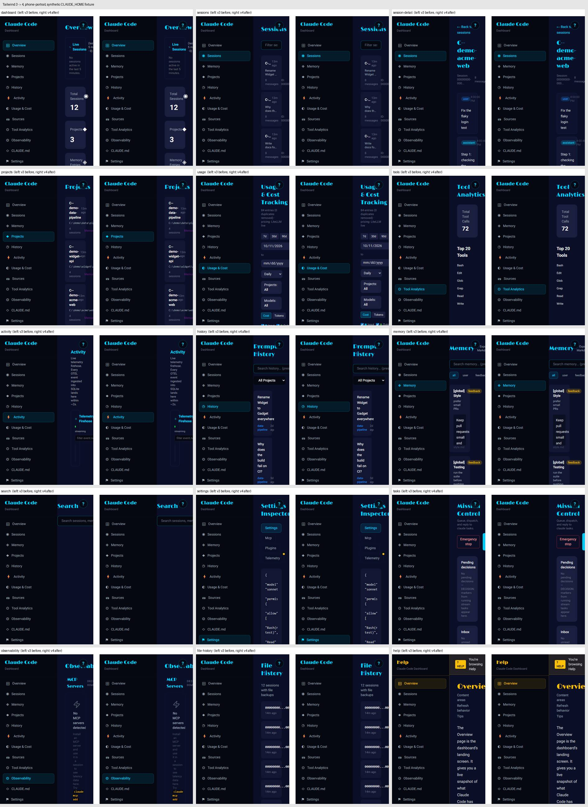
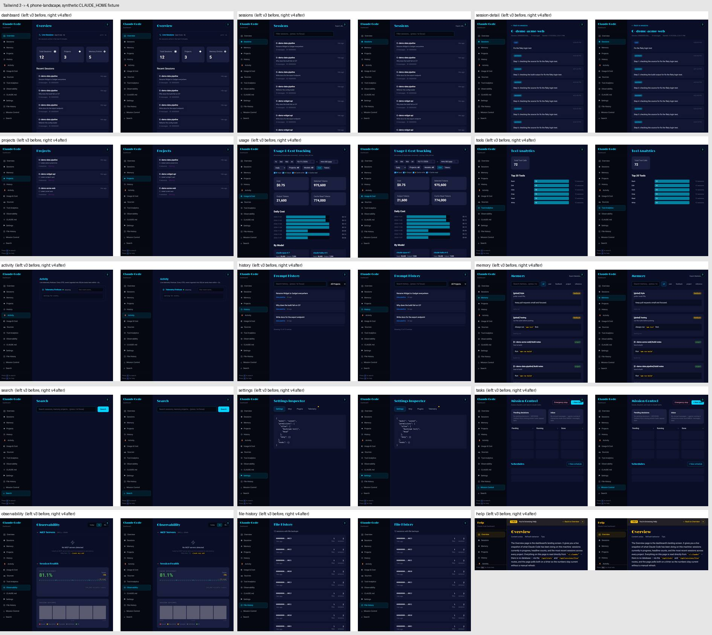
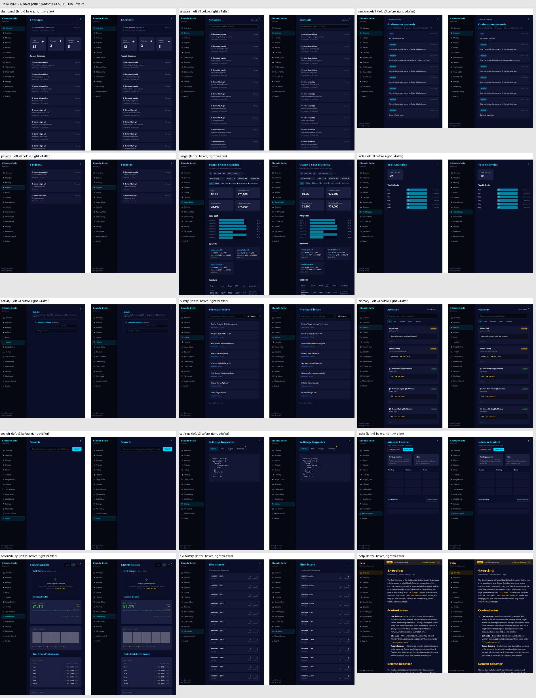
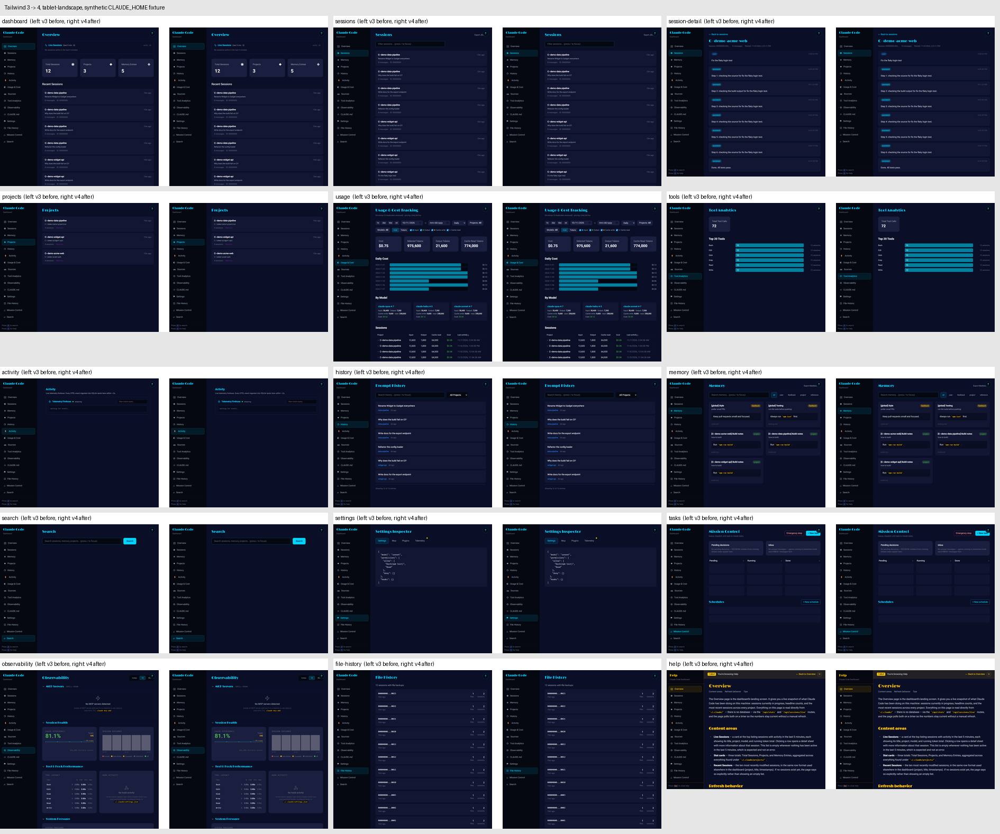
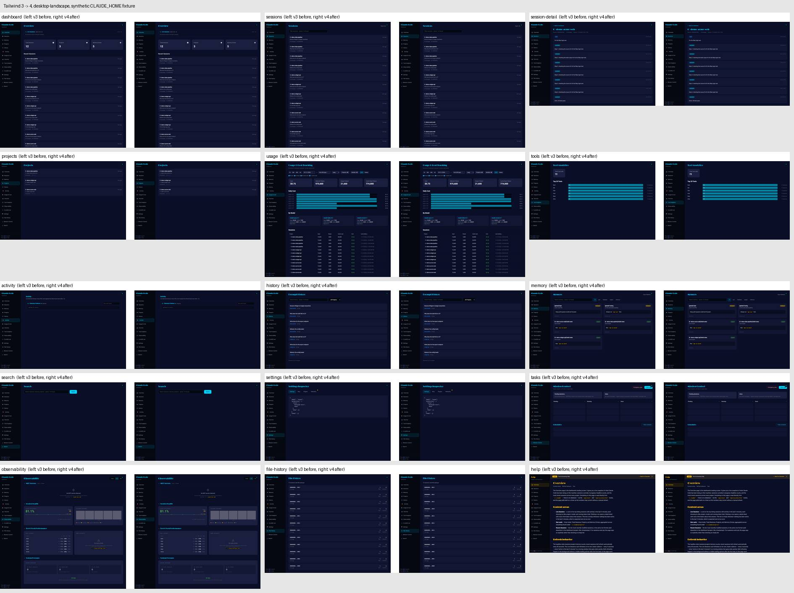
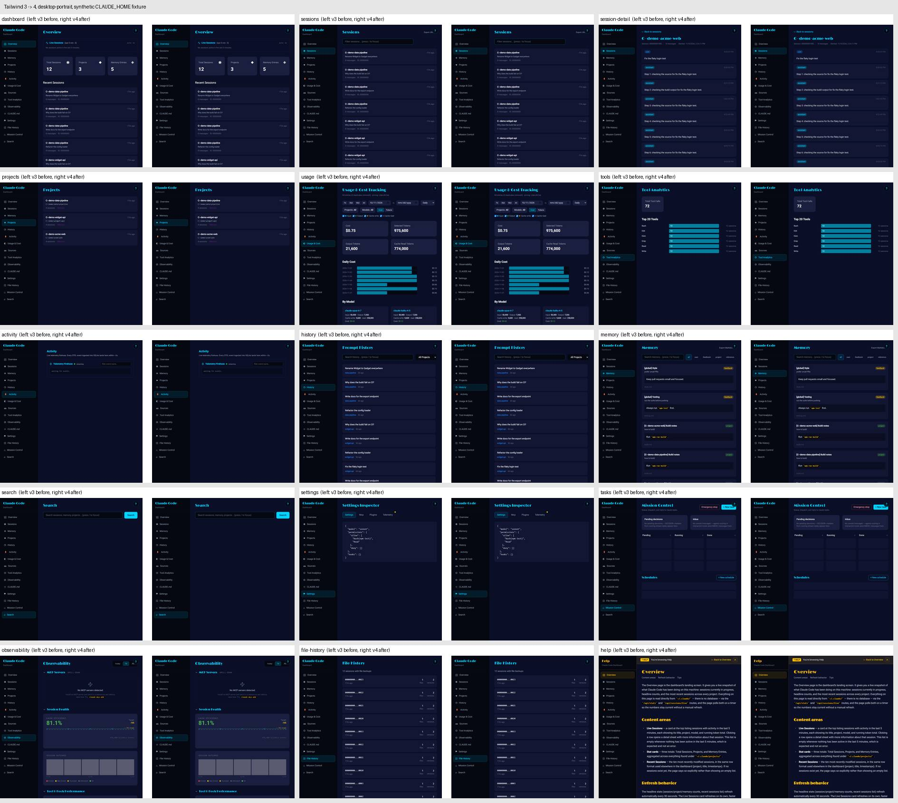

# Tailwind CSS 3 → 4 migration

Date: 2026-11-09. Decision D8 (security sweep).

## Why

`tailwindcss@3.4.19` brought in `braces@3.0.3` through `chokidar` and `micromatch`.
Snyk lists it as SNYK-JS-BRACES-19963945 (High), and braces has no fixed release.
Tailwind 4 doesn't depend on braces, so after this change braces is no longer a
production dependency.

One path is left, and it's dev-only:
`eslint-config-next → @next/eslint-plugin-next → fast-glob@3.3.1 → micromatch → braces`.
It runs at lint time and is never shipped or served. An override can't fix it,
because braces has no fixed release.

## What changed

- `tailwindcss` ^3 → ^4.3.3, plus `@tailwindcss/postcss` ^4.3.3. Version 4.3.4 was
  less than 7 days old, so the minimum-age rule ruled it out.
- `postcss.config.mjs` uses `@tailwindcss/postcss`. `autoprefixer` was removed,
  since Tailwind 4 adds vendor prefixes itself.
- `tailwind.config.ts` was removed. The theme now lives in `@theme` in
  `app/globals.css`: brand colors, chameleon palette, fonts, and the `dark`
  class variant.
- `@tailwindcss/typography` is loaded with `@plugin`. The upgrade tool had
  dropped it, which would have left every `prose` class unstyled.
- Renamed utilities, applied by `npx @tailwindcss/upgrade@4.3.3`:
  - `rounded` → `rounded-sm`, `rounded-sm` → `rounded-xs`
  - `focus:outline-none` → `focus:outline-hidden`
  - `backdrop-blur` → `backdrop-blur-sm`
  - `bg-gradient-to-t` → `bg-linear-to-t`
  - `break-words` → `wrap-break-word`
  - `[&>*]:h-full` → `*:h-full`
- Compatibility styles in `app/globals.css` keep the v3 look:
  - Default border color is gray-200. v4 uses `currentcolor`.
  - Placeholder color is gray-400 on inputs and textareas.
  - Buttons get `cursor: pointer`.
  - Line heights for `text-xs` through `text-4xl` are fixed rem values, as in v3.
    v4 uses unitless ratios, which nested `text-[10px]` spans inherit and
    rescale. That made every live-session row and the sidebar key hints about
    3px shorter.
- `app/dashboard/tasks/page.tsx`: the two composer drawers moved out of the
  `space-y-6` stack. v4 puts `space-y` margins on every child except the last,
  so the trailing fixed drawers left 24px of empty space under the page. In v3
  the drawers also took a 24px top margin, which pushed the task composer 24px
  down and cut off its bottom. Both problems are gone now.

## Visual verification

Pages were captured with Playwright against `next start` builds of
`origin/master` (v3) and this branch (v4). Both builds read the same synthetic
`CLAUDE_HOME` fixture, so no real session data appears. There are 17 pages,
each at 6 sizes: phone 390×844, tablet 768×1024 and desktop 1440×900, in
portrait and landscape. That is 102 pairs. No page overflows horizontally at
any size.

Per-image pixel diff (threshold 16/255): `screenshots/tailwind-4/pixel-diff.txt`.

The differences that remain are expected:

- **Date inputs on `/dashboard/usage`** are about 1px shorter. v4's preflight
  zeroes the vertical padding on WebKit date fields. Nothing is clipped. The
  whole page is 2–4px shorter only where the controls wrap onto extra rows.
  See `usage-date-input-tablet.jpg`.
- **Text antialiasing.** Some text renders with subpixel antialiasing instead
  of grayscale, for example session titles and the history project filter.
  Glyphs and positions are the same.
- **Mission Control drawer.** It now opens flush with the top of the viewport.
  This is the bug fix described above. See `tasks-composer-drawer-desktop.jpg`.

Contact sheets compare v3 (left) with v4 (right) at each size. They leave out
`/dashboard/claude-md` and `/dashboard/sources`, because those pages show the
local fixture path. Neither page differs beyond one status-dot pixel block.

The line-height regression as it looked before the fix (v3, v4 before the fix,
diff): `screenshots/tailwind-4/line-height-before-fix.jpg`.

## Problems that were already there

These exist on `origin/master` too, and this change doesn't touch them:

- Below about 640px wide, the sidebar stays at full width and squeezes the main
  column, so Mission Control's header and buttons get clipped.
- `tests/api/sync-route.test.ts` fails on Windows with `EBUSY` when it deletes
  its temporary SQLite file.
